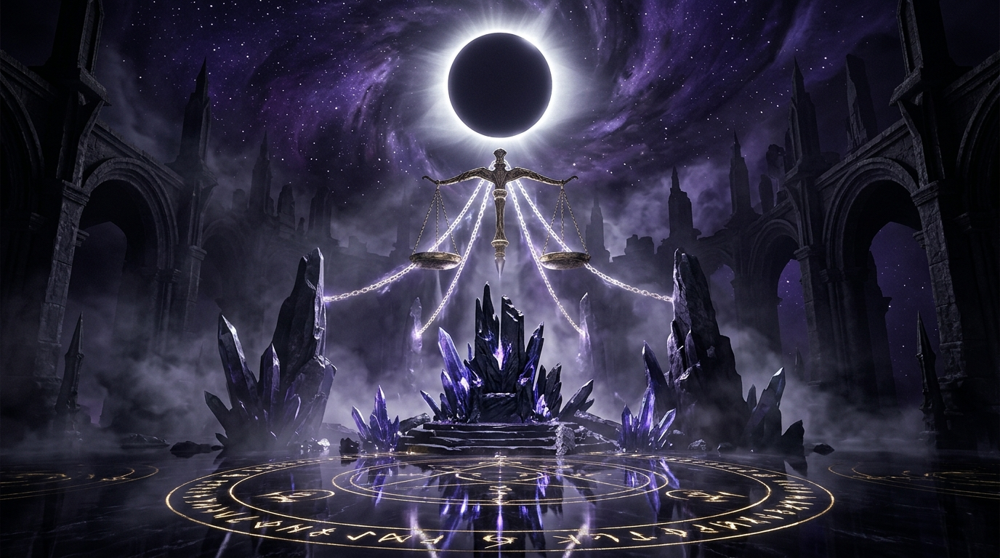

# ⛧ HÀN BỐI THÁP - KẺ LỪA ĐẢO THẦN LINH
> **Hồ Sơ Nhân Vật SSS & Tuyển Tập 20 Bối Cảnh Quái Đàm Đắc Giá (Empty Sceneries / Concept Art Archive)**  
> *Trích xuất từ 2 video: `Mg9IlgHE7zE` (Full Mùa 1) & `KIRyZv9jUpc` (Full Mùa 2 mốc 4365s)*



---

## 🌟 Giới Thiệu Dự Án

Dự án cung cấp một bộ công cụ web tương tác và thư viện concept art hoàn chỉnh về nhân vật **Hàn Bối Tháp (韩贝塔 - Han Beita / Hàn Beta)** cùng **20 bối cảnh quái đàm siêu thực** đặc sắc nhất qua hai mùa phim:
- **100% Không Có Nhân Vật (Empty Sceneries):** Toàn bộ 20 bối cảnh đều sạch bóng người, đóng vai trò làm phông nền (background assets) cho game 2D/3D, sân khấu visual novel, truyện tranh và sa bàn diorama.
- **Tích Hợp Prompt AI 8K:** Mỗi bối cảnh đi kèm một prompt tiếng Anh chuẩn nhiếp ảnh điện ảnh (Midjourney v6, Stable Diffusion XL, DALL-E 3) để tạo dựng hình ảnh với chất lượng Unreal Engine 5.
- **Trải Nghiệm Tương Tác Web Dark Fantasy:** Giao diện ma mị, hiệu ứng ánh sáng thần bí, âm thanh khí quyển ma mị (Web Audio API), tính năng tung đồng xu hai mặt và rút bài Tarot quái đàm mô phỏng phong cách chiến đấu của Hàn Bối Tháp.

---

## 🃏 Phần I: Hồ Sơ Nhân Vật - Hàn Bối Tháp (Hàn Beta)

- **Tên nhân vật:** Hàn Bối Tháp (韩贝塔 - Han Beita)
- **Danh xưng:** *Hàn Beta*, *Kẻ Lừa Đảo Thần Linh*, *Kẻ Bán Bùa Hẻm Cũ*
- **Thiên phú & Đẳng cấp:**
  - *Vỏ bọc ban đầu:* F-Rank (Điểm 0) - Kẻ lừa đảo bán bùa rởm.
  - *Thực tế thức tỉnh:* **SSS "Kẻ Lừa Dối Cả Thần Linh" (Deceiver of Gods)**.
- **Đạo cụ đặc trưng:**
  1. *Bộ bài Tarot Số Phận:* Dùng để gài bẫy và tráo đổi quy tắc vận mệnh giữa các thực thể.
  2. *Đồng xu định mệnh hai mặt:* Dụng cụ tâm lý chiến dùng để đặt cược tính mạng và xoay chuyển niềm tin đối thủ.
  3. *Gương phản chiếu linh hồn:* Khắc chế các thực thể quái đàm nhìn trộm và lật ngược sát thương ảo cảnh.
- **Cơ chế chiến đấu / Sinh tồn:**
  - **"Lấy giả làm thật" (Deception into Reality):** Không dựa vào cơ bắp thuần túy; vũ khí tối thượng là Tâm lý chiến, Lừa gạt cấp cao và Đổi trắng thay đen. Thao túng cả các vị thần cai quản phó bản để viết lại luật chơi tử thần.

---

## 🏰 Phần II: Tuyển Tập 20 Bối Cảnh (Empty Sceneries)

### 🔴 Mùa 1: Quy Tắc Quái Đàm Sơ Trung Cấp (`Mg9IlgHE7zE`)
1. **Sạp Bói Toán Hẻm Cũ Của Hàn Bối Tháp** *(Thế giới thực)*
2. **Không Gian Chờ Vô Hạn** *(Infinite White Void Lobby)*
3. **Sảnh Đón Tiếp Bệnh Viện Nửa Đêm** *(Midnight Hospital Reception)*
4. **Phòng Mổ Bí Mật Số 7** *(Forbidden Operating Theater)*
5. **Hành Lang Chung Cư Tầng 4 - Phòng 404** *(Blood Apartment 4th Floor)*
6. **Lớp Học Ban Đêm Trường Cấp Ba Bỏ Hoang** *(Midnight Cursed Classroom)*
7. **Ga Tàu Điện Ngầm Tuyến Số 0** *(Abyssal Subway Station)*
8. **Lò Hỏa Táng Nhà Tang Lễ U Linh** *(Spectral Crematorium)*
9. **Sòng Bạc Tử Thần Hoàng Gia** *(The Death Casino)*
10. **Đại Sảnh Khách Sạn Sương Mù** *(Mist Hotel Grand Foyer)*

### 🟣 Mùa 2: Cấp Thần & Vũ Trụ Thời Không (`KIRyZv9jUpc`)
11. **Đấu Trường Giác Đấu La Mã Đẫm Máu** *(Colosseum of the Damned)*
12. **Điện Thờ Thần Linh Phế Tích** *(Ruined Pantheon of Fallen Gods)*
13. **Cung Điện Phán Xét Của Thần Linh** *(The Divine Judgment Court - Mốc đặc biệt 4365s)*
14. **Mê Cung Bánh Răng Thời Gian** *(Chrono Gear Clockwork Labyrinth)*
15. **Thư Viện Cấm Thuật Vô Tận** *(Forbidden Celestial Library)*
16. **Tứ Hợp Viện Bát Quái Cổ U Linh** *(Haunted Ancient Courtyard)*
17. **Phòng Thí Nghiệm Nuôi Cấy Thần Tế Bào** *(Divine Mutation Bio-Chamber)*
18. **Bờ Biển Cát Đen & Ngọn Hải Đăng Ma** *(Black Sand Beach & Ghost Lighthouse)*
19. **Cổng Trời Phong Ấn Vực Thẳm** *(Celestial Stargate of Sealing)*
20. **Ngai Vàng Vực Thẳm Hư Vô** *(The Void Throne of Deception)*

---

## 💻 Hướng Dẫn Sử Dụng & Trải Nghiệm

1. **Chạy trực tiếp trên trình duyệt:**
   - Mở trực tiếp file `index.html` bằng bất kỳ trình duyệt hiện đại nào (Chrome, Edge, Firefox, Brave).
   - Hoặc khởi chạy local server:
     ```bash
     npx serve .
     # hoặc
     python -m http.server 8080
     ```
2. **Tính năng trên ứng dụng:**
   - **Âm Khí Quyển:** Nhấn nút trên thanh header để kích hoạt âm thanh drone ma mị tự tổng hợp bằng Web Audio API.
   - **Bộ lọc & Tìm kiếm:** Lọc theo Mùa 1, Mùa 2 hoặc tìm kiếm nhanh theo từ khóa địa danh.
   - **Tung Đồng Xu Định Mệnh:** Trải nghiệm cơ chế đặt cược tâm lý của Hàn Bối Tháp.
   - **Rút Bài Tarot Quái Đàm:** Khám phá 10 quy tắc sinh tồn quái đàm ẩn.
   - **Xuất File Prompt:** Nhấn nút "📥 Xuất Tất Cả Prompt AI" để tải xuống trọn bộ 20 prompt dạng `.txt`.

---

## 📂 Cấu Trúc Mã Nguồn

```
├── assets/
│   └── images/
│       ├── hero_divine_judgment.jpg   # Ảnh Cung Điện Phán Xét Của Thần Linh
│       └── death_casino.jpg           # Ảnh Sòng Bạc Tử Thần Hoàng Gia
├── index.html                         # Giao diện chính Semantic HTML5
├── style.css                          # Hệ thống thiết kế CSS Dark Fantasy & Glassmorphism
├── app.js                             # Logic ứng dụng, Web Audio Synth, Data 20 Scenes
├── Boicanh_HanBoiThap_20Scenes.md      # Tài liệu kịch bản gốc
├── AGENTS.md                          # Hướng dẫn cấu hình AI Agent
└── README.md                          # Tài liệu giới thiệu dự án
```

---
*Tác quyền & phát triển bởi hungdz22072014.*
